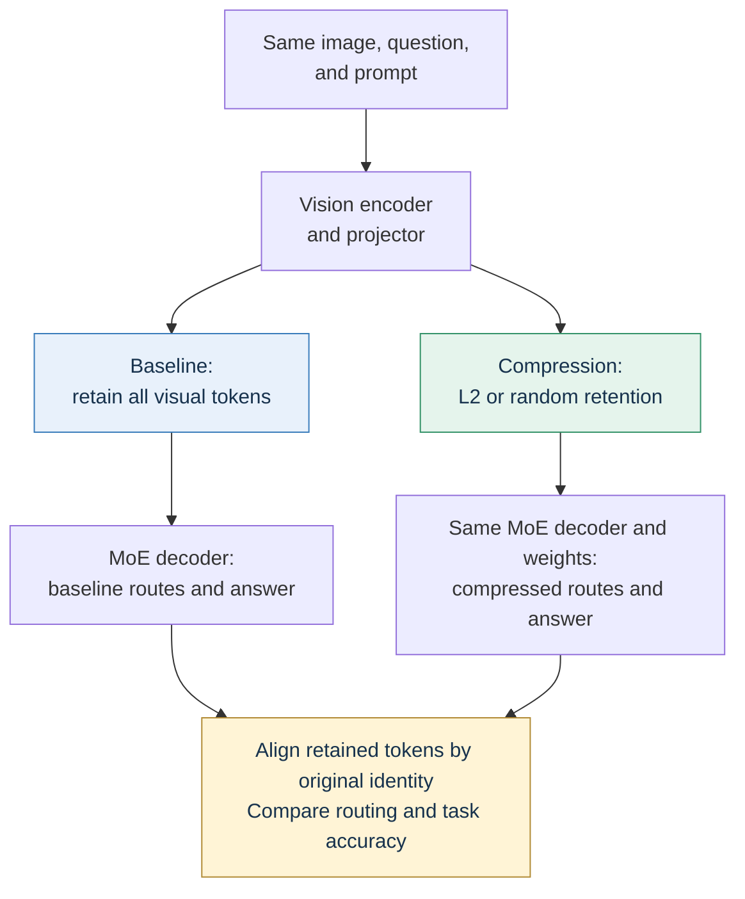
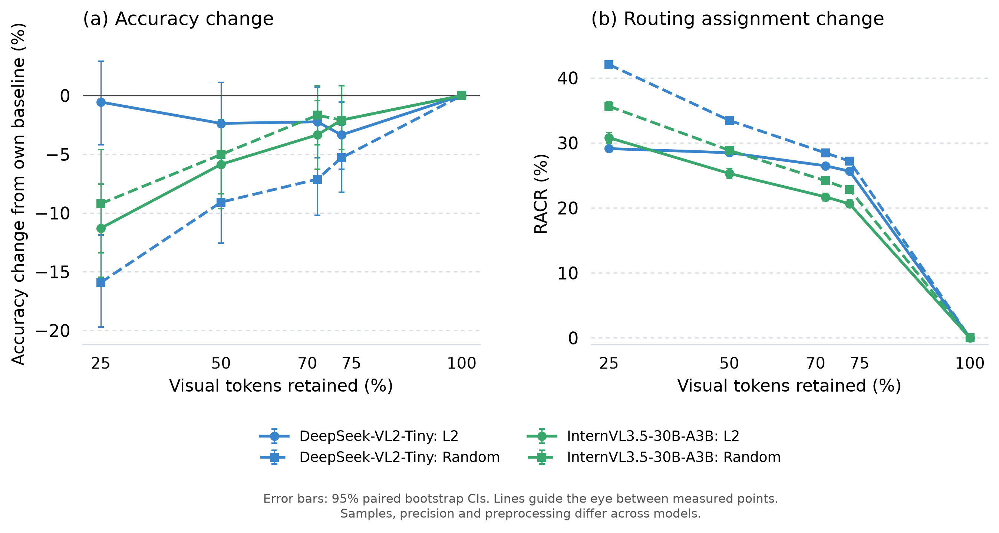
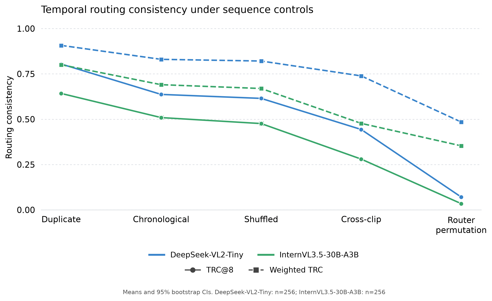

# Beyond Independent Optimization

Code, retained experimental evidence, and manuscript assets for **Compression, MoE Routing, and Quantization Interactions in Multimodal Edge Intelligence**.

This survey examines how token compression, expert routing, numerical precision, and hardware constraints interact during multimodal inference. The experiments here measure two of those interactions: compression-induced routing changes and temporal routing consistency under frame controls.

[Paper overview](#how-the-compression-experiment-works) · [Main results](#main-results) · [Reproduce the figures](#rebuild-existing-tables-and-figures-without-a-gpu) · [Run experiments](#run-model-experiments)

## What the paper finds

- **Pruning changes the routing of tokens that remain.** This is measured in DeepSeek-VL2-Tiny and InternVL3.5-30B-A3B on ScienceQA.
- **Routing stability and accuracy can diverge.** Keeping more baseline expert assignments does not consistently produce a more accurate answer.
- **Temporal routing consistency detects input structure.** Repeated, shuffled, and unrelated frames change TRC, but the evaluated samples do not establish TRC as a predictor of answer correctness.

The practical outcome is to evaluate efficiency methods with **both task-quality and routing diagnostics**. These observations do not establish routing drift as the cause of accuracy loss, or demonstrate that preserving routing improves performance.

## How the compression experiment works



**L2 selection** retains tokens with the largest embedding norms; random selection provides a matched token-budget control. **RACR** (routing assignment change rate) measures the fraction of baseline Top-k expert assignments not preserved for retained tokens. A value of 0% means their selected expert sets are unchanged. The comparison follows the same tokens before and after pruning, rather than comparing unrelated token positions.

## Main results

### 1. Compression changes downstream expert routing



*Left: accuracy change relative to each model's own unpruned baseline, expressed as a percent of baseline accuracy. Right: RACR (%). Error bars show the saved 95% paired bootstrap intervals; lines connect measured budgets.*

**Snapshot at 50% visual-token retention.** Unpruned accuracy is **71.60%** for DeepSeek-VL2-Tiny (FP16, n=1,000) and **93.36%** for InternVL3.5-30B-A3B (expert-NF4, n=256).

| Model | Selection | Accuracy (%) | Accuracy change (pp) | RACR (%) |
|---|---|---:|---:|---:|
| DeepSeek-VL2-Tiny | L2 | 69.90 | −1.70 | 28.49 |
| DeepSeek-VL2-Tiny | Random | 65.10 | −6.50 | 33.46 |
| InternVL3.5-30B-A3B | L2 | 87.89 | −5.47 | 25.30 |
| InternVL3.5-30B-A3B | Random | 88.67 | −4.69 | 28.86 |

**How to read this:** L2 selection has lower routing change than random selection in both models. For InternVL, however, random selection has higher observed accuracy at this budget. That dissociation is why routing change should be measured alongside accuracy rather than treated as an accuracy surrogate. The table reports point estimates; full confidence intervals are in the [source values](results/paper_tables/exp1_paper_values.csv).

Accuracy changes in the table are **percentage points (pp)**; the left figure uses **relative percent change**. Compare pruning methods within each model: sample sizes, precision, and preprocessing differ between models, so absolute cross-model values are not paired comparisons.

### 2. Temporal routing consistency responds to frame structure

The NExT-QA experiment uses **eight sampled frames as separate images**, with 256 questions per model. It compares chronological frames with repeated-frame, shuffled-frame, and cross-clip controls.



*Colors distinguish models. Solid lines show TRC@8; dashed lines show weighted TRC. Error bars are saved 95% bootstrap intervals. Router permutation relabels stored expert distributions and is a routing-only diagnostic, with no separate answer-generating run.*

**How to read this:** repeated frames produce higher consistency, while shuffling and cross-clip substitution reduce it relative to chronological input. Higher consistency does not necessarily mean better answers: for InternVL, repeated frames have higher TRC@8 (**0.6422**) than chronological frames (**0.5089**), but lower accuracy (**74.61% vs. 87.89%**).

For both models and both headline TRC metrics, the confidence interval for the difference between correct and incorrect questions includes zero. Thus these samples show sensitivity to input structure without demonstrating a reliable association with correctness. See the [temporal result values](results/paper_tables/exp2_paper_values.csv), [DeepSeek correctness analysis](results/published/deepseek/temporal_routing/accuracy_relation.csv), and [InternVL correctness analysis](results/paper_tables/internvl_accuracy_relation.csv).

> **Evidence scope:** the figures summarize completed DeepSeek and InternVL runs. The additional Qwen3.5/Qwen3.6 experiments have runners and tests but no included real-data measurements. See [results provenance](docs/RESULTS.md) for the retained evidence and its limits.

## From experiments to paper figures

| Research question | Code entry point | Included evidence |
|---|---|---|
| Does pruning change retained-token routing? | [Compression runner](experiments/compression_routing/run.py), [InternVL/Qwen runner](experiments/multimodel/run.py) | [DeepSeek summary](results/published/deepseek/compression_routing/summary.csv), [InternVL sweep](results/published/internvl/retention_sweep/summaries/summary.csv) |
| Does TRC respond to temporal controls? | [Temporal runner](experiments/temporal_routing/run.py), [multimodel analysis](experiments/multimodel/analyze.py) | [DeepSeek temporal CSVs](results/published/deepseek/temporal_routing), [InternVL executed notebook](results/evidence/internvl_experiments_1_2.ipynb) |
| How are the displayed comparisons rebuilt? | [Paper reproduction script](tools/reproduce_paper.py) | [Consolidated paper tables](results/paper_tables), [figure assets](paper/figures) |

## Start here

- **Rebuild the existing empirical figures/tables on a CPU or Mac:** follow the commands below.
- **Run the additional 122B-model experiments on an H200:** use [the minor-revision guide](experiments/minor_revision/README.md).
- **Reproduce the completed InternVL retention sweep:** use [the multimodel guide](experiments/multimodel/README.md).
- **Understand which measurements are included:** read [results provenance](docs/RESULTS.md) and [experiment status](docs/EXPERIMENTS.md).

## Repository layout

```text
experiments/             Standalone runners, analysis, tests, and Kaggle launchers
  compression_routing/  DeepSeek ScienceQA compression/routing experiment
  temporal_routing/     DeepSeek NExT-QA routing controls
  multimodel/           InternVL3.5 and Qwen3-VL adapters; full InternVL sweep
  textvqa/              TextVQA extension
  temporal_accuracy/    Paired temporal-perturbation extension
  control_accuracy/     Follow-up generation for missing control accuracies
  minor_revision/       Qwen3.5 122B/35B and optional Qwen3.6 revision experiments
results/
  published/            Unmodified supplied measurements and metadata
  evidence/             Original executed InternVL notebook, with evidence outputs
  paper_tables/         Consolidated CSVs and empirical LaTeX tables
paper/                  Manuscript, bibliography, figure assets, TMLR style files
tools/                  Reproduction, validation, notebook bundling, release packaging
environments/           Separate CPU test dependency profiles
experimental/gemma4/    Unresolved prototype; outside the supported runner workflows
docs/                   Reproducibility, provenance, development, release notes
```

Generated runs go in `artifacts/` or the experiment's ignored output directory. Downloaded upstream code belongs in `external/`; weights, dataset caches, environments and generated ZIPs are excluded from Git.

## Rebuild existing tables and figures without a GPU

Use Python 3.12 or newer:

```bash
python3.12 -m venv .venv-analysis
source .venv-analysis/bin/activate
python -m pip install -r requirements-analysis.txt
python tools/check_repository.py
python tools/reproduce_paper.py
```

Outputs appear under `artifacts/reproduction/tables/` and `artifacts/reproduction/figures/`. This reconstructs the empirical figures and table values from the supplied CSVs and executed notebook; it does not rerun model inference or recover unavailable raw routes. Retained published evidence is not overwritten.

## Run model experiments

Different model families require different Transformers/runtime versions. Install each in a **separate environment**; use the experiment guides rather than installing all requirements into one environment.

| Workflow | Guide | Hardware / runtime |
|---|---|---|
| Additional larger-model validation | [Minor revision](experiments/minor_revision/README.md) | H200; Transformers 5.5.0 |
| InternVL full sweep / Qwen3-VL replication | [Multimodel](experiments/multimodel/README.md) | CUDA; Transformers 4.57.6 |
| Original compression/routing | [Compression](experiments/compression_routing/README.md) | Legacy DeepSeek/FastMMoE stack |
| Temporal routing controls | [Temporal routing](experiments/temporal_routing/README.md) | Legacy DeepSeek stack |
| TextVQA extension | [TextVQA](experiments/textvqa/README.md) | CUDA; shared compression helper included |
| Graded temporal perturbations | [Temporal accuracy](experiments/temporal_accuracy/README.md) | CUDA; separate legacy environment |
| Missing control accuracies | [Control accuracy](experiments/control_accuracy/README.md) | Self-contained Kaggle launcher; Python 3.11 |

For the H200 workflow, begin with the guide's smoke command. The smoke test still loads the entire model. Full-size GPU execution is not part of repository-preparation validation.

## Kaggle and source archives

```bash
python tools/build_kaggle_bundle.py all
python tools/build_release.py
```

These write archives to ignored `dist/`. Kaggle bundle folder names match the existing notebook lookup patterns even though the repository uses cleaner names. For the self-contained control-accuracy notebook, rebuild its embedded code with `python experiments/control_accuracy/build_notebook.py`.

## Development and manuscript

See [development/testing](docs/DEVELOPMENT.md), [the manuscript build guide](paper/README.md), and [the release notes](docs/RELEASE.md). CPU tests check code and synthetic model contracts; paper claims must use completed real-data runs with recorded provenance.

The supplied manuscript retains anonymized author and publication metadata. A project-wide software license and final paper citation have not been assigned by this repository preparation; those decisions belong to the paper's authors. External models, data and bundled TMLR style files retain their own terms; see [third-party sources](docs/THIRD_PARTY.md).
