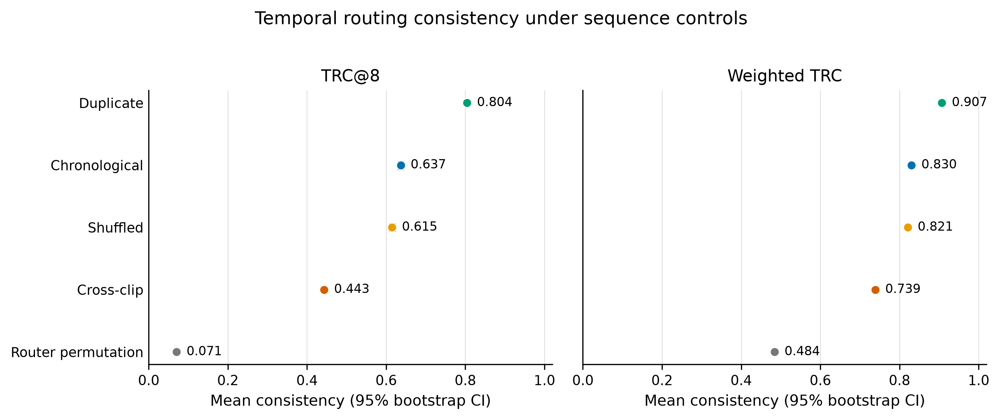
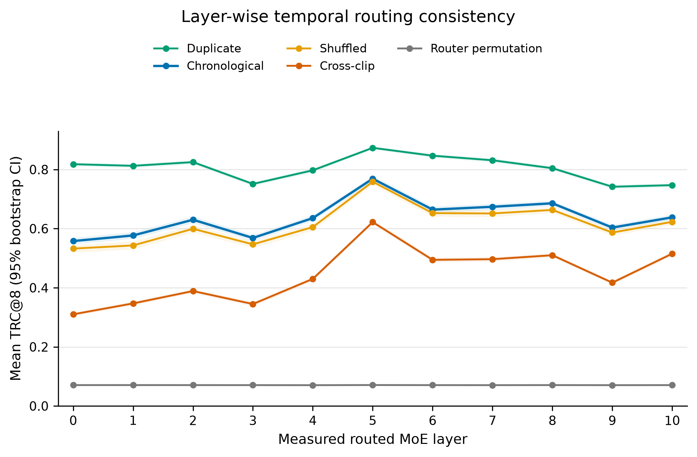
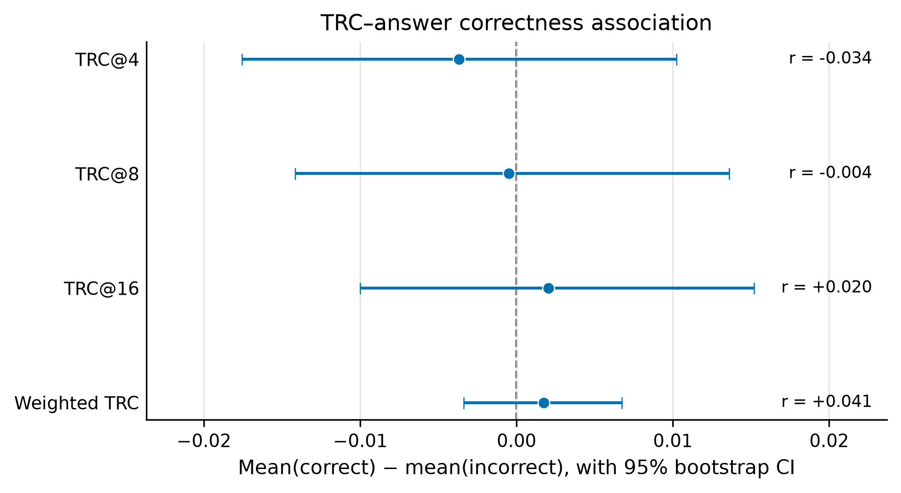

# Experiment 2: Figures and Interpretation

## Experimental context

Experiment 2 evaluates whether Temporal Routing Consistency (TRC) is a meaningful diagnostic of adjacent-frame MoE routing. DeepSeek-VL2-Tiny was evaluated on 256 NExT-QA questions, using eight uniformly sampled frames presented as a multi-image sequence. The chronological input produced 162 correct answers out of 256, corresponding to 63.28% accuracy.

The experiment compares five routing conditions:

- **Duplicate:** the same frame is repeated eight times, providing a positive consistency control.
- **Chronological:** the eight sampled frames retain their original temporal order.
- **Shuffled:** the same frames are randomly reordered, preserving frame content while disrupting temporal adjacency.
- **Cross-clip:** the sequence contains unrelated frames, providing a strong temporal-content control.
- **Router permutation:** expert identities are independently permuted while preserving marginal routing distributions.

TRC@8 is the primary metric. It compares the eight experts receiving the greatest aggregate routing mass in adjacent frames. Weighted TRC is the prespecified companion metric and compares the complete routing-mass distributions.

---

## Figure 1: TRC under temporal controls

### Results

| Condition | TRC@8, mean [95% CI] | Weighted TRC, mean [95% CI] |
|---|---:|---:|
| Duplicate | 0.8045 [0.8019, 0.8069] | 0.9072 [0.9067, 0.9077] |
| Chronological | 0.6367 [0.6303, 0.6430] | 0.8302 [0.8278, 0.8326] |
| Shuffled | 0.6148 [0.6074, 0.6223] | 0.8209 [0.8180, 0.8239] |
| Cross-clip | 0.4433 [0.4397, 0.4469] | 0.7389 [0.7373, 0.7404] |
| Router permutation | 0.0706 [0.0705, 0.0707] | 0.4844 [0.4833, 0.4856] |

The controls follow the expected qualitative ordering. Repeating one frame produces the greatest routing consistency. Chronological sequences have higher consistency than shuffled versions of the same frames, while unrelated cross-clip frames reduce consistency substantially. Randomizing expert identities produces the lowest TRC@8 value.

The chronological-minus-shuffled paired difference is 0.0219 for TRC@8 (95% CI [0.0181, 0.0258]) and 0.0094 for weighted TRC (95% CI [0.0080, 0.0107]). Because the content and frame count are unchanged in this comparison, this result shows that the metric responds to the presented temporal ordering rather than only to the marginal visual content.

The much larger chronological-minus-cross-clip differences—0.1934 for TRC@8 and 0.0914 for weighted TRC—show that both metrics are also sensitive to whether adjacent frames belong to a coherent video sequence. The agreement between TRC@8 and weighted TRC indicates that the conclusion does not depend solely on hard top-expert selection.

### Paper-ready caption

> **Temporal routing consistency under sequence controls.** Points show mean TRC across 256 NExT-QA examples, and horizontal bars show 95% clip-bootstrap confidence intervals. Duplicate frames produce the greatest routing consistency, chronological ordering exceeds shuffled ordering of the same frames, and cross-clip and expert-identity permutation controls reduce consistency. TRC@8 and weighted TRC yield the same qualitative ordering.

### Main conclusion from Figure 1

TRC is a control-sensitive diagnostic of adjacent-frame expert-routing consistency. In particular, it detects the relatively small effect of reordering the same frames as well as the much larger effect of replacing them with unrelated visual content.

---

## Figure 2: Layer-wise TRC@8

### Results

The expected control ordering is present across all 11 measured routed MoE layers:

\[
\text{Duplicate} > \text{Chronological} > \text{Shuffled} > \text{Cross-clip} > \text{Router permutation}.
\]

Chronological TRC@8 is layer-dependent rather than constant. It ranges from 0.5580 at measured layer 0 to a peak of 0.7689 at measured layer 5. Shuffled routing follows a similar layer profile but remains below chronological routing at every measured layer. Cross-clip routing is lower throughout, while router-permutation TRC@8 remains close to 0.071 across the network.

The similar shape of the chronological and shuffled curves suggests that some layer-wise variation reflects the model's general routing organization. Their persistent separation indicates an additional contribution from temporal ordering. The cross-clip separation is larger, showing that visual continuity has a stronger routing effect than order disruption alone in this setup.

### Paper-ready caption

> **Layer-wise TRC@8 under temporal controls.** Curves show mean TRC@8 across 256 examples, with shaded 95% clip-bootstrap confidence intervals. The expected control ordering is retained at every measured routed MoE layer. Chronological and shuffled sequences have similar layer-wise profiles, but chronological routing remains more consistent, while cross-clip and expert-permutation controls are substantially lower.

### Main conclusion from Figure 2

The control-sensitive TRC result is distributed across the routed MoE stack and is not produced by one anomalous layer. At the same time, the magnitude of TRC is layer-dependent, so layer aggregation should be defined in advance rather than selecting a favorable layer after observing results.

---

## Figure 3: Relationship between TRC and answer correctness

### Results

| Metric | Mean correct | Mean incorrect | Correct − incorrect [95% CI] | Point-biserial correlation |
|---|---:|---:|---:|---:|
| TRC@4 | 0.6733 | 0.6770 | −0.0037 [−0.0176, 0.0102] | −0.0343 |
| TRC@8 | 0.6366 | 0.6370 | −0.0005 [−0.0142, 0.0136] | −0.0045 |
| TRC@16 | 0.6367 | 0.6347 | 0.0020 [−0.0100, 0.0152] | 0.0199 |
| Weighted TRC | 0.8309 | 0.8291 | 0.0017 [−0.0034, 0.0068] | 0.0410 |

All four confidence intervals cross zero, and all correlations are close to zero. For the primary metric, correct questions have a mean TRC@8 of 0.6366 and incorrect questions have a mean of 0.6370. Thus, chronological clip-level TRC does not separate correct and incorrect answers in this sample.

This result does not contradict the control findings in Figures 1 and 2. The controls test whether TRC responds to changes in temporal structure, whereas this analysis compares different questions whose correctness can be affected by question difficulty, visual ambiguity, frame coverage, and other factors. Experiment 2 therefore establishes measurement sensitivity but does not establish downstream predictive validity.

### Paper-ready caption

> **Association between chronological TRC and answer correctness.** Points show the mean TRC difference between correctly and incorrectly answered NExT-QA questions, and horizontal bars show 95% clip-bootstrap confidence intervals. All intervals include zero, and the corresponding point-biserial correlations are small, indicating no reliable clip-level association between TRC and correctness in this experiment.

### Main conclusion from Figure 3

Natural variation in chronological TRC is not a reliable predictor of answer correctness. The downstream relationship is investigated more directly in Experiment 3 using matched temporal-order perturbations of the same question and frames.

---

## Combined interpretation

The three figures support a focused conclusion:

> TRC@8 and weighted TRC are control-sensitive measurements of adjacent-frame MoE-routing consistency in the evaluated DeepSeek-VL2-Tiny and frame-sampled NExT-QA setting. They respond reliably to temporal reordering, unrelated-frame controls, and expert-identity permutation across all measured routed layers. However, natural clip-level TRC does not distinguish correct from incorrect answers.

Accordingly, Experiment 2 supports using TRC as an internal routing diagnostic. It does not yet support treating high TRC as a guarantee of correct video understanding or as a validated optimization objective.

## Recommended placement in the paper

- **Main paper:** Figure 1, because it provides the clearest evidence that the proposed metric is nontrivial and control-sensitive.
- **Main paper or appendix:** Figure 2, depending on space. It demonstrates that the effect is distributed across layers.
- **Appendix or short task-relevance subsection:** Figure 3. It transparently reports the accuracy analysis while keeping the main narrative centered on the validated diagnostic result.

## Scope statement

The evaluated model processes sampled frames as a multi-image sequence. These results should therefore be described as frame-sequence inference with an image MoE-VLM rather than native-video inference.
