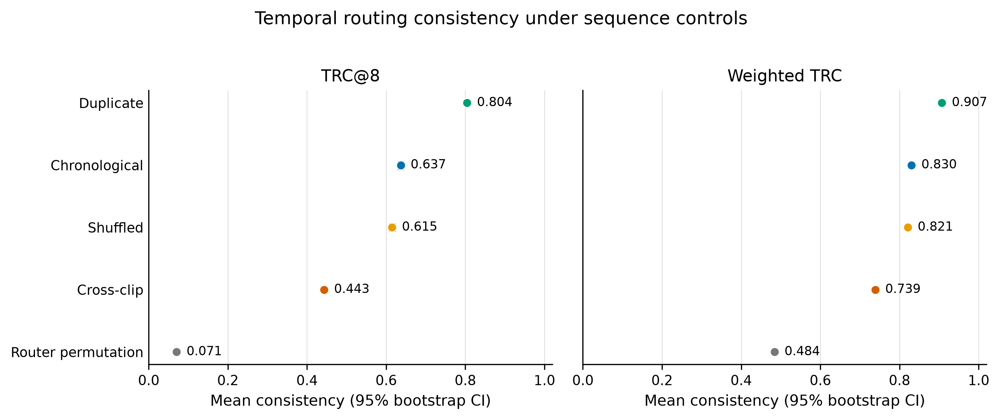
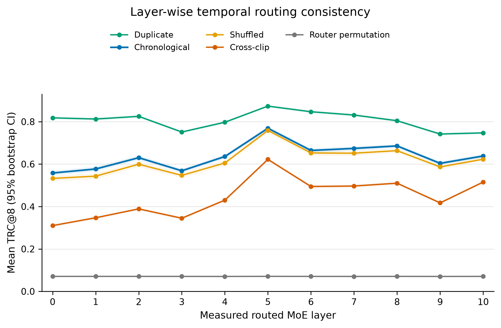
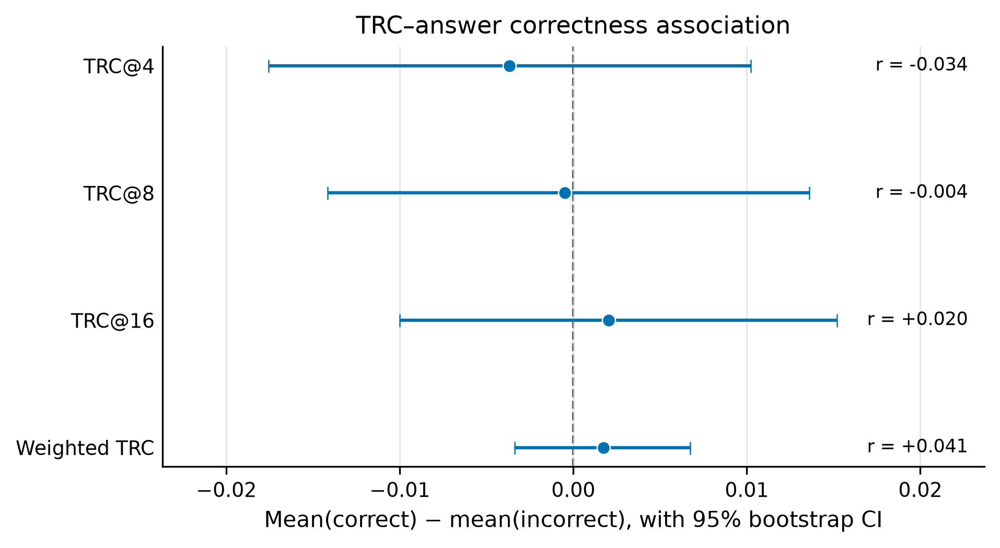

# Experiment 2: plots and interpretation

## Experimental context

Experiment 2 evaluates Temporal Routing Consistency (TRC) for DeepSeek-VL2-Tiny on 256 NExT-QA questions. Eight uniformly sampled frames are presented as a multi-image sequence. Consequently, the experiment evaluates temporal structure in sampled-frame inference and should not be described as native-video inference.

The model answered 162 of 256 questions correctly, corresponding to an accuracy of 63.28%. The routing analysis compares five conditions:

- **Duplicate:** the same frame is repeated eight times.
- **Chronological:** eight frames are presented in their original order.
- **Shuffled:** the same eight frames are randomly reordered.
- **Cross-clip:** unrelated frames are combined into one sequence.
- **Router permutation:** expert identities are independently permuted while the marginal routing distributions are preserved.

TRC@8 is the primary metric. Weighted TRC is the prespecified companion metric. Union TRC is not plotted because it remains approximately one across conditions and therefore saturates in this token-rich Top-k routing setting.

---

## Figure 1: condition-level routing consistency



### What the figure shows

Both TRC@8 and weighted TRC follow the expected control ordering:

| Condition | Mean TRC@8 | 95% CI | Mean weighted TRC | 95% CI |
|---|---:|---:|---:|---:|
| Duplicate | 0.8045 | [0.8019, 0.8069] | 0.9072 | [0.9067, 0.9077] |
| Chronological | 0.6367 | [0.6303, 0.6430] | 0.8302 | [0.8278, 0.8326] |
| Shuffled | 0.6148 | [0.6074, 0.6223] | 0.8209 | [0.8180, 0.8239] |
| Cross-clip | 0.4433 | [0.4397, 0.4469] | 0.7389 | [0.7373, 0.7404] |
| Router permutation | 0.0706 | [0.0705, 0.0707] | 0.4844 | [0.4833, 0.4856] |

The paired chronological-minus-shuffled difference is 0.0219 for TRC@8, with a 95% bootstrap CI of [0.0181, 0.0258]. The corresponding weighted-TRC difference is 0.0094 [0.0080, 0.0107]. Thus, preserving chronological order produces a small but reliable increase over shuffling the same visual content.

The contrast becomes substantially larger when temporal and semantic continuity are removed. Chronological TRC@8 exceeds cross-clip TRC@8 by 0.1934 [0.1862, 0.2002]. It exceeds the router-permutation baseline by 0.5661 [0.5594, 0.5729]. These effects show that the metric is not explained only by marginal expert frequencies.

The duplicate condition is intentionally highest. This is a measurement-validity control: identical visual inputs should produce similar routing patterns. It does not imply that duplicated frames provide better video understanding.

### Paper-ready caption

> **Temporal routing consistency under sequence controls.** Points show mean TRC with clip-bootstrap 95% confidence intervals over 256 NExT-QA questions. Repeating one frame produces the highest consistency, chronological ordering exceeds shuffling of the same frames, cross-clip sequences are substantially lower, and independently permuting expert identities produces the lowest TRC@8. Weighted TRC yields the same qualitative ordering.

---

## Figure 2: layer-wise TRC@8



### What the figure shows

TRC@8 is layer-dependent rather than constant throughout the language model. Chronological TRC@8 ranges from 0.5580 at measured layer 0 to 0.7689 at measured layer 5. Layer 5 is also the maximum for the duplicate, shuffled, and cross-clip conditions:

| Condition | TRC@8 at measured layer 5 |
|---|---:|
| Duplicate | 0.8734 |
| Chronological | 0.7689 |
| Shuffled | 0.7588 |
| Cross-clip | 0.6222 |
| Router permutation | 0.0709 |

Although absolute consistency varies by layer, the control result is not produced by one anomalous layer. At every one of the 11 measured routed MoE layers:

- duplicate TRC@8 is higher than chronological TRC@8;
- chronological TRC@8 is higher than shuffled TRC@8;
- shuffled TRC@8 is higher than cross-clip TRC@8; and
- router permutation remains near 0.071.

The chronological and shuffled curves are close, particularly in the later layers, but chronological ordering remains consistently higher. The wider separation from cross-clip inputs shows that routing consistency responds more strongly when both sequence coherence and visual-content continuity are disrupted.

### Paper-ready caption

> **Layer-wise TRC@8 under temporal controls.** Lines show mean TRC@8 and shaded clip-bootstrap 95% confidence intervals across the 11 measured routed MoE layers. Absolute consistency is layer-dependent and peaks at measured layer 5, while the expected control ordering persists at every layer. This demonstrates that the aggregate control effect is distributed across the model rather than driven by a single layer.

---

## Figure 3: relationship with answer correctness



### What the figure shows

The figure reports the mean TRC difference between questions answered correctly and incorrectly. Positive values would indicate higher TRC for correct answers. All four confidence intervals cross zero:

| Metric | Mean(correct) − mean(incorrect) | 95% CI | Point-biserial correlation |
|---|---:|---:|---:|
| TRC@4 | −0.0037 | [−0.0176, 0.0102] | −0.0343 |
| TRC@8 | −0.0005 | [−0.0142, 0.0136] | −0.0045 |
| TRC@16 | 0.0020 | [−0.0100, 0.0152] | 0.0199 |
| Weighted TRC | 0.0017 | [−0.0034, 0.0067] | 0.0410 |

For the primary TRC@8 metric, correct questions have a mean of 0.6366 and incorrect questions have a mean of 0.6370. The difference and correlation are effectively zero. Therefore, natural variation in chronological clip-level TRC does not identify whether the model answers a question correctly.

This result does not negate the control sensitivity shown in Figures 1 and 2. It distinguishes two claims:

1. TRC detects changes in adjacent-frame routing structure, which is supported.
2. Higher naturally occurring TRC predicts downstream correctness, which is not supported by this between-question analysis.

Question difficulty, visual ambiguity, and frame coverage vary across questions and can dominate binary correctness. This limitation motivates Experiment 3, which compares multiple temporal perturbations of the same question and video using correct-option margin as the primary outcome.

### Paper-ready caption

> **Association between TRC and answer correctness.** Points show the mean difference between correctly and incorrectly answered chronological sequences; horizontal bars are bootstrap 95% confidence intervals. All intervals include zero, and point-biserial correlations are close to zero. Thus, while TRC is sensitive to controlled sequence perturbations, natural clip-level TRC does not distinguish correct from incorrect answers in this evaluation.

---

## Combined conclusion

The figures support a focused conclusion: TRC@8 and weighted TRC are control-sensitive diagnostics of adjacent-frame MoE-routing consistency in the evaluated DeepSeek-VL2-Tiny sampled-frame setting. They distinguish repeated, chronological, shuffled, unrelated, and expert-permuted inputs, and this ordering persists across all measured routed layers. However, chronological clip-level TRC alone does not predict binary NExT-QA correctness.

### Suggested paper placement

- **Main paper:** Figure 1, because it provides the clearest evidence that TRC responds to temporal and routing controls.
- **Main paper or appendix:** Figure 2, depending on available space. It establishes that the result is distributed across layers.
- **Appendix or short downstream-analysis paragraph:** Figure 3. It transparently motivates the paired within-question design of Experiment 3 without making the null result the main narrative.

### Paper-ready result paragraph

> Across 256 NExT-QA questions, chronological sequences produced higher routing consistency than shuffled versions of the same frames: mean TRC@8 increased from 0.6148 to 0.6367, with a paired difference of 0.0219 and a 95% bootstrap confidence interval of [0.0181, 0.0258]. Cross-clip sequences were substantially lower at 0.4433, while the expert-identity permutation baseline reached only 0.0706. Weighted TRC reproduced the same ordering, and the expected control direction held across all 11 measured routed MoE layers. These findings establish TRC as a control-sensitive routing diagnostic in the evaluated sampled-frame setting. Its downstream relationship with answer accuracy requires a matched within-question analysis, which is addressed in Experiment 3.

---

## Reproducing the figures

From the repository root, run:

```bash
python experiment_2_TRC/plot_results.py
```

The script reads the CSV files in `experiment_2_TRC/Result` and writes PNG and PDF versions of all three figures into this directory. To generate SVG files as well:

```bash
python experiment_2_TRC/plot_results.py --formats png pdf svg
```
